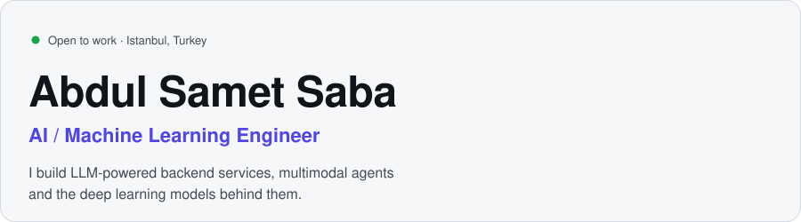
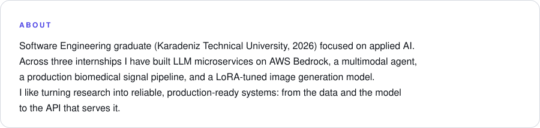
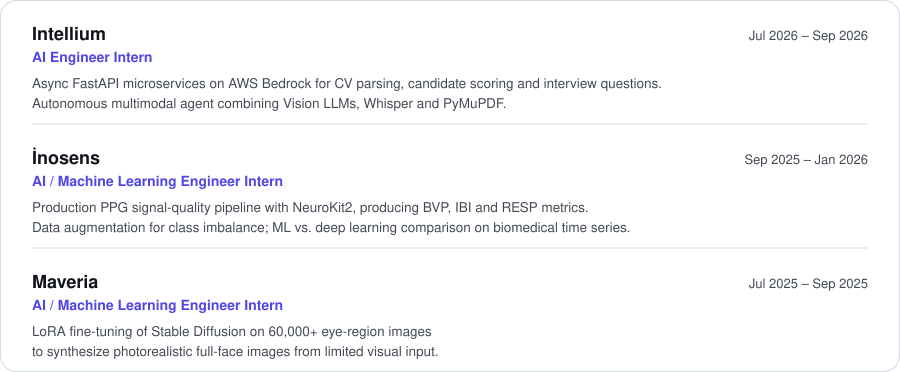
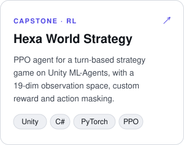
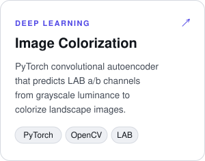
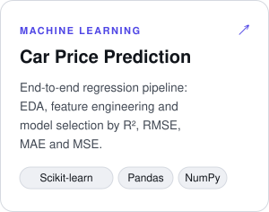
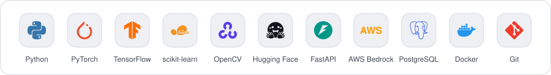

<picture>
  <source media="(prefers-color-scheme: dark)" srcset="assets/intro-night.svg" />
  
</picture>

  <a href="https://www.linkedin.com/in/abdul-samet-saba-b28627254/"><picture><source media="(prefers-color-scheme: dark)" srcset="assets/link-linkedin-night.svg" /></picture></a>
  <a href="mailto:sametsaba84@gmail.com"><picture><source media="(prefers-color-scheme: dark)" srcset="assets/link-email-night.svg" /></picture></a>
  <a href="https://github.com/Abdulsametsaba?tab=repositories"><picture><source media="(prefers-color-scheme: dark)" srcset="assets/link-github-night.svg" /></picture></a>

<picture>
  <source media="(prefers-color-scheme: dark)" srcset="assets/about-night.svg" />
  
</picture>

<picture>
  <source media="(prefers-color-scheme: dark)" srcset="assets/label-experience-night.svg" />
  
</picture>

<picture>
  <source media="(prefers-color-scheme: dark)" srcset="assets/experience-night.svg" />
  
</picture>

<picture>
  <source media="(prefers-color-scheme: dark)" srcset="assets/label-projects-night.svg" />
  
</picture>

  <a href="https://github.com/Abdulsametsaba/hexa-world-strategy"><picture><source media="(prefers-color-scheme: dark)" srcset="assets/project-hexa-night.svg" /></picture></a>
  <a href="https://github.com/Abdulsametsaba/visual-colorization-deep-learning"><picture><source media="(prefers-color-scheme: dark)" srcset="assets/project-colorization-night.svg" /></picture></a>
  <a href="https://github.com/Abdulsametsaba/Car_price_estimate"><picture><source media="(prefers-color-scheme: dark)" srcset="assets/project-car-price-night.svg" /></picture></a>

<picture>
  <source media="(prefers-color-scheme: dark)" srcset="assets/label-tools-night.svg" />
  
</picture>

<picture>
  <source media="(prefers-color-scheme: dark)" srcset="assets/label-stack-night.svg" />
  
</picture>

<picture>
  <source media="(prefers-color-scheme: dark)" srcset="assets/stack-night.svg" />
  
</picture>

<picture>
  <source media="(prefers-color-scheme: dark)" srcset="https://raw.githubusercontent.com/Abdulsametsaba/Abdulsametsaba/output/github-contribution-grid-snake-dark.svg" />
  
</picture>

<a href="mailto:sametsaba84@gmail.com"><picture><source media="(prefers-color-scheme: dark)" srcset="assets/contact-night.svg" /></picture></a>
